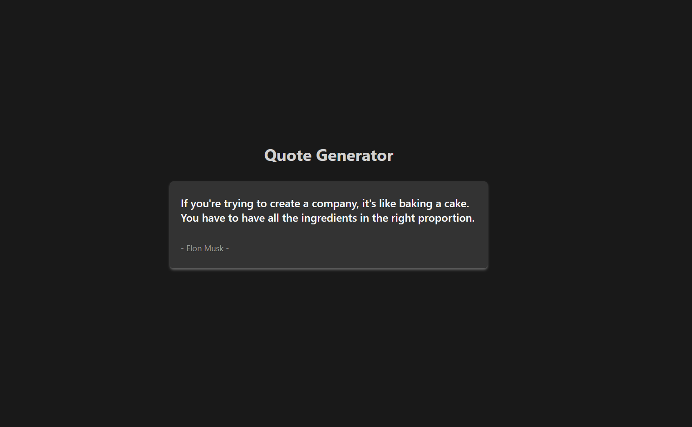
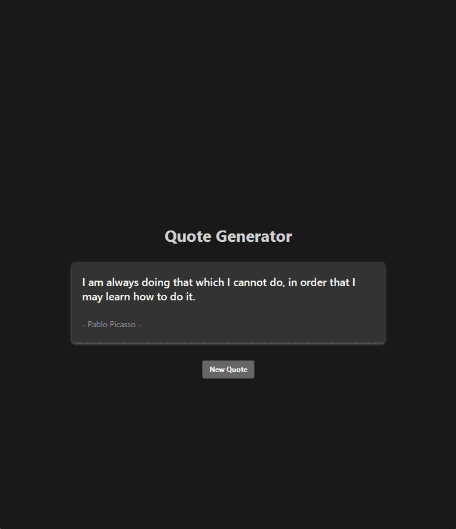
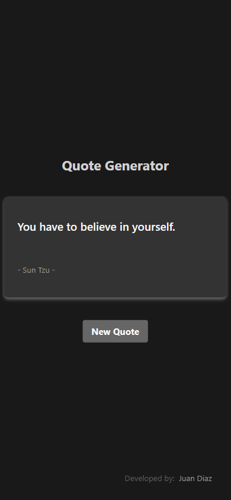
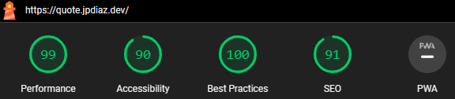

<div id="top"></div>

# Random Quote 🎲

This project is a responsive web app that fetches random quotes from an API and allows users to tweet them.

## Description 💡

This project was built as part of the **[freeCodeCamp Front End Libraries Certification](https://www.freecodecamp.org/certification/1diazdev/front-end-development-libraries)**. The goal was to build a random quote machine with React.

<div align="center">

[](https://quote.jpdiaz.dev/)
[](https://stackblitz.com/github.com/JuanPabloDiaz/random-quote-generator)

</div>

### Desktop View 🖥️



### iPad view 📱



### Mobile view 📱



### Lighthouse Score 🚀



## Features:

- Responsive design: [Random Quote](https://quote.jpdiaz.dev) adapts to any screen size, ensuring a consistent and enjoyable experience for all users.
- Sleek and modern UI: Tailwind CSS provides a beautiful and intuitive user interface.
- Efficient and performant: Vite.js ensures fast loading times and a smooth experience.

### Built With 🔑

Welcome to [Random Quote](https://quote.jpdiaz.dev), a simple and intuitive pomodoro timer built with React.js, Vite.js, and Tailwind CSS.


Here's a closer look at the tech stack:

- Front-End: React.js, Vite.js, Tailwind CSS
- Back-End: N/A
- Deployment: Vercel

## Get started 🛠️

To get started with [Random Quote](https://quote.jpdiaz.dev), simply clone the repository and follow the setup instructions. You'll be up and running in no time!

### Setup 📋

1. Clone the repo
2. Install dependencies
   ```sh
   npm install
   ```
3. Start the development server
   ```sh
   npm run dev
   ```
4. Open [http://localhost:5173/](http://localhost:5173/) with your browser to see the result.

## Contribution 🤝

All contributions are welcome. Please read the [CONTRIBUTING guidelines](CONTRIBUTING.md) for details on our code of conduct, and the process for submitting pull requests.

## License 📜

[Random Quote](https://quote.jpdiaz.dev) is licensed under the MIT License.

I hope you enjoy using the Random Quote!

<!-- OTHER PROJECTS -->

## Other Projects 🚀


[](https://github.com/JuanPabloDiaz/platzi/tree/main/2021)
[](https://github.com/JuanPabloDiaz/platzi/tree/main/2022)
[](https://github.com/JuanPabloDiaz/platzi/tree/main/2023)

<!-- CONTACT -->

## Contact 📞

[](https://www.linkedin.com/in/1diazdev/)
[](https://www.twitter.com/JuanDiaz_427)
[](mailto:juan.diaz93@hotmail.com)

[](https://platzi.com/p/DiazJuan/)

<!-- ACKNOWLEDGMENTS -->

## Acknowledgments 📚

Resources list that I find helpful and would like to give credit to.

- [Tailwind CSS](https://tailwindcss.com/)
- [Vite.js](https://vitejs.dev/)
- [React.js](https://reactjs.org/)
- [Vercel](https://vercel.com/)
- [Breaking Bad Quotes API](https://breakingbadquotes.xyz)

<p align="right">(<a href="#top">👆 Top 👆</a>)</p>
